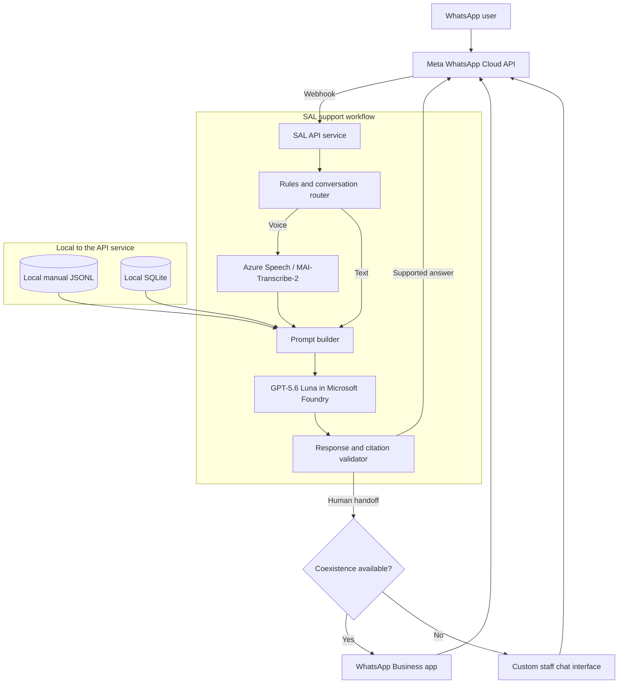
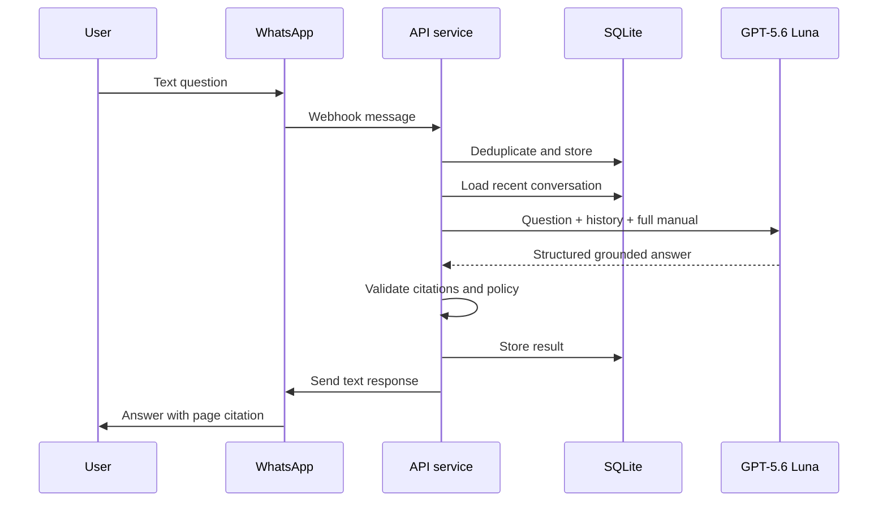
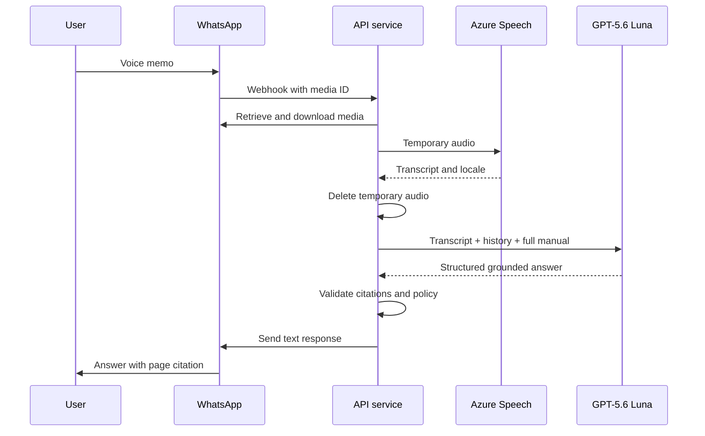
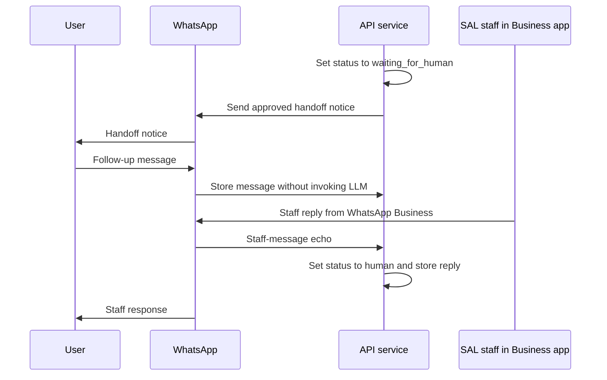

# SAL WhatsApp Support Assistant - Solution Design

**Status:** Draft for prototype implementation  
**Date:** September 15, 2026  
**Audience:** SAL product, program, engineering, safeguarding, and operations teams

## 1. Executive summary

This document describes an initial support assistant for Start A Library Trust (SAL).
End users ask questions through WhatsApp using text or voice messages. The assistant
answers from the SAL Teacher Librarian Guide, responds in English or Kiswahili, cites
the relevant manual pages, and transfers unsupported or sensitive requests to a human.

The initial prototype uses:

- Meta WhatsApp Cloud API for messaging.
- WhatsApp Business App Coexistence for staff handoff when SAL has an eligible
  Coexistence-enabled business number.
- A Node.js and TypeScript API service.
- GPT-5.6 Luna deployed in Microsoft Foundry for language understanding and grounded
  answer generation.
- MAI-Transcribe-2 or Azure Speech for English and Kiswahili voice transcription.
- The complete processed manual supplied to the LLM on each request.
- Local SQLite storage for conversations, message state, feedback, and audit events.
- The existing `knowledge-base\sal\data\sal-guide-chunks.jsonl` file as the authoritative knowledge
  source.

The prototype deliberately avoids an agent framework, embedding service, vector
database, and distributed job infrastructure. The manual is small enough to fit in
the model context, and expected initial traffic is low. Components are isolated behind
interfaces so local hybrid retrieval can be added later without changing WhatsApp or
conversation behavior.

## 2. Goals

The prototype must:

1. Receive WhatsApp text and voice messages.
2. Answer questions using only the approved SAL manual.
3. Support English, Kiswahili, and mixed-language enquiries.
4. Respond in the user's language using concise WhatsApp-friendly text.
5. Cite the manual chapter and PDF page range for factual answers.
6. Refuse to invent answers when the manual is insufficient.
7. Transfer conversations to a human when requested or required.
8. Apply deterministic safeguarding and emergency routing rules.
9. Keep the manual, conversation history, identifiers, and operational data local to
   the API service.
10. Keep the Azure model deployment replaceable through configuration.

## 3. Constraints and assumptions

- The prototype uses the processed 44-page SAL Teacher Librarian Guide knowledge bundle
  with 57 semantic sections and 58 chunks; five image-transcribed appendix chunks
  require final human proofing.
- Initial user volume is low enough that one Azure generation call per normal message
  is acceptable.
- The API service has persistent local disk or an attached persistent volume.
- The public deployment provides HTTPS endpoints reachable by Meta webhooks.
- Continuing to use WhatsApp for staff replies requires a WhatsApp Business number
  eligible for the Coexistence feature. If SAL does not have such a number, the
  prototype requires a protected custom staff chat interface for human replies.

## 4. Key architecture decisions

### 4.1 Use full-manual context for the MVP

The API sends all 58 structured manual chunks to GPT-5.6 Luna with each user question.
This avoids retrieval misses and removes the need for embeddings, a vector index, query
rewriting, and reranking.

The API preserves chunk boundaries and metadata:

```text
<manual_chunk
  id="sal-0423ac330bdd"
  title="Setting Up a Child-Friendly Library Space"
  chapter="Chapter 2: Practical School Library Operations"
  pages="8-9"
  language="en"
>
...
</manual_chunk>
```

This is preferred for the prototype because the corpus is small, implementation is
simple, and the absolute model cost remains low at the expected volume.

### 4.2 Use deterministic orchestration rather than an agent

Application code controls every step. The LLM cannot decide to call arbitrary tools,
send messages, access files, or update state.

```text
Receive message
-> validate and deduplicate
-> apply routing rules
-> transcribe when needed
-> construct grounded prompt
-> invoke Azure LLM
-> validate structured result
-> send answer or create handoff
```

This provides predictable behavior, simpler testing, explicit failure handling, and a
clear audit trail.

### 4.3 Keep business data local to the API service

The complete manual, WhatsApp identifiers, message history, staff notes, feedback, and
audit records remain in local files or SQLite. Azure receives only the minimum context
required to process the current request.

### 4.4 Respond to voice messages with text initially

Voice input is transcribed, but the initial response is text. Text responses are easier
to review, cite, search, and audit. Azure text-to-speech and WhatsApp voice responses
can be added later.

## 5. High-level architecture



## 6. Component design

### 6.1 WhatsApp adapter

Responsibilities:

- Verify webhook subscription challenges.
- Validate incoming webhook authenticity according to Meta requirements.
- Parse text, audio, contact, and message identifiers.
- Deduplicate incoming message IDs.
- Retrieve voice-media metadata and download audio using authorized Meta endpoints.
- Send text responses.
- Record delivery and failure status updates.

The adapter exposes provider-neutral application types:

```ts
interface IncomingSupportMessage {
  providerMessageId: string;
  contactId: string;
  type: "text" | "voice";
  text?: string;
  mediaId?: string;
  receivedAt: string;
}

interface MessagingProvider {
  downloadAudio(mediaId: string): Promise<DownloadedAudio>;
  sendText(contactId: string, text: string): Promise<SentMessage>;
}
```

### 6.2 Conversation service

Responsibilities:

- Find or create the active conversation.
- Maintain `bot`, `waiting_for_human`, `human`, and `closed` states.
- Load a limited number of recent messages.
- Pause automated replies while a human owns the conversation.
- Store inbound, generated, and staff messages.
- Store model results, citations, feedback, and failure reasons.

### 6.3 Rules and policy router

Rules run before the LLM and take precedence over generated output.

Initial deterministic rules:

- Explicit request for a human.
- Stop or opt-out request.
- Conversation already assigned to a human.
- Empty or unsupported media.
- Audio exceeding configured duration or size.
- Repeated processing of the same provider message ID.
- Approved safeguarding and emergency keywords or flows.

The LLM may recommend handoff, but only the application changes conversation state.

### 6.4 Speech transcription service

Primary implementation:

- MAI-Transcribe-2 in Azure Speech where available and approved.
- Azure Speech with `en-KE` and `sw-KE` support as fallback.

Responsibilities:

- Validate MIME type, size, and configured duration.
- Save audio under a random temporary filename.
- Transcribe English, Kiswahili, or mixed-language speech.
- Return transcript text and detected language when available.
- Delete the temporary recording after processing.
- Reject empty or unusable transcripts.

```ts
interface SpeechTranscriber {
  transcribe(input: {
    bytes: Uint8Array;
    mimeType: string;
    candidateLocales: string[];
  }): Promise<{
    text: string;
    locale?: string;
  }>;
}
```

For safeguarding concerns, names, dates, phone numbers, or other consequential details,
the assistant asks the user to confirm the transcript before relying on it.

### 6.5 Knowledge repository

The authoritative source is:

```text
knowledge-base\sal\data\sal-guide-chunks.jsonl
```

The service loads and validates this file at startup. Every record must contain:

- `id`
- `title`
- `chapter`
- `section`
- `topic`
- `tags`
- `content_type`
- `language`
- `page_start`
- `page_end`
- `text`

Startup must fail visibly if:

- the file is missing;
- a JSON line is invalid;
- chunk IDs are duplicated;
- required metadata is absent;
- a page range is invalid.

The repository creates a stable, bounded manual-context string once at startup and
reuses it for requests.

### 6.6 LLM gateway

The LLM gateway hides Azure SDK and deployment details:

```ts
interface LanguageModelGateway {
  answerSupportQuestion(input: {
    question: string;
    inputLanguage?: string;
    recentMessages: ChatMessage[];
    manualContext: string;
  }): Promise<SupportModelResult>;
}
```

Configuration:

```env
AZURE_AI_ENDPOINT=
AZURE_AI_API_KEY=
AZURE_LLM_DEPLOYMENT=gpt-5.6-luna
AZURE_LLM_REASONING_EFFORT=low
AZURE_LLM_MAX_OUTPUT_TOKENS=600
```

The implementation uses an Azure SDK supported by the selected deployment. No
model-specific behavior should leak into the conversation or WhatsApp adapters.

### 6.7 Prompt builder

The prompt contains:

1. SAL assistant role and scope.
2. Safeguarding and refusal instructions.
3. Response-language instructions.
4. Recent conversation messages.
5. All structured manual chunks.
6. The current user message or voice transcript.
7. A strict structured-output schema.

Core instructions:

```text
- Answer only from the supplied manual chunks.
- Respond in the user's language.
- Keep the answer concise and suitable for WhatsApp.
- Preserve names, numbers, schedules, requirements, and procedures exactly.
- Cite only chunk IDs included in the supplied manual.
- If the manual is insufficient, set supported=false.
- Do not make safeguarding, eligibility, legal, medical, or financial decisions.
- Recommend human handoff when the request requires individual judgment.
```

### 6.8 Response validator

Expected model output:

```ts
interface SupportModelResult {
  language: "en" | "sw" | "mixed" | "unknown";
  answer: string;
  supported: boolean;
  citedChunkIds: string[];
  requiresHuman: boolean;
  handoffReason?: string;
}
```

Local validation must confirm:

- The response matches the schema.
- Every cited chunk ID exists.
- Supported factual answers include at least one citation.
- The answer length is within the configured limit.
- Unsupported answers do not present manual-derived claims as confirmed facts.
- Human handoff is created when `requiresHuman` is true.

If validation fails, the service sends a safe fallback and records the model response
for engineering review. It does not send malformed or ungrounded content.

### 6.9 Human handoff channel

The preferred prototype handoff preserves SAL's existing staff workflow through
WhatsApp Business App Coexistence.

With Coexistence, the same SAL business number is connected to:

```text
WhatsApp Business app used by SAL staff
                    +
WhatsApp Cloud API used by the assistant
```

The required flow is:

```text
Bot determines that handoff is required
-> API changes conversation status to waiting_for_human
-> user receives an approved handoff message
-> staff sees and answers the conversation in WhatsApp Business
-> API receives the staff-message echo
-> conversation status changes to human
-> automated replies remain paused
```

The application must subscribe to and process the relevant message-echo webhook so it
can distinguish staff messages from bot-generated outbound messages. While a
conversation is in `waiting_for_human` or `human` state, incoming user messages are
stored but are not sent to the LLM.

This option requires:

- A SAL phone number registered with the WhatsApp Business app.
- Eligibility and enablement for WhatsApp Business App Coexistence.
- Successful connection of that number to the Cloud API.
- A tested staff-message echo flow.

Coexistence must be confirmed before changing or migrating SAL's active support number.
The team should test onboarding and handoff with a separate number first.

If SAL has no Coexistence-enabled number, staff cannot use the same WhatsApp Business
app conversation as the Cloud API assistant. In that case, the solution must include
a protected custom staff chat interface that sends staff replies through the Cloud API.

### 6.10 Custom staff chat interface

This component is required only when Coexistence is unavailable, or later when SAL
needs stronger assignment, reporting, and multi-agent capabilities.

The minimal staff interface supports:

- Listing conversations waiting for a human.
- Viewing recent messages, transcript, generated answer, and cited chunks.
- Claiming a conversation.
- Sending a manual WhatsApp reply.
- Returning a conversation to bot mode.
- Closing a conversation.
- Marking an answer correct, incorrect, or requiring review.

Authentication can use one simple deployment-appropriate mechanism for the prototype,
but the inbox must not be publicly accessible.

## 7. Message flows

### 7.1 Text question



### 7.2 Voice question



### 7.3 Human handoff

Triggers include:

- The user explicitly requests a person.
- The manual does not contain enough information.
- The question is case-specific or requires judgment.
- A safeguarding or emergency rule is triggered.
- Voice transcription is too uncertain for a consequential request.
- Model output fails validation.

User response:

```text
I cannot confirm that from the SAL guide. I have forwarded your question to a
staff member, who can reply in this conversation.
```

The exact message is localized and approved by SAL.

#### Coexistence handoff



#### Custom-interface fallback

When Coexistence is unavailable:

```text
waiting_for_human conversation
-> appears in protected staff interface
-> staff claims conversation
-> staff writes response
-> API sends response through WhatsApp Cloud API
-> bot remains paused until staff closes or releases conversation
```

## 8. Local persistence

SQLite is the single prototype data store.

### 8.1 Suggested schema

```sql
CREATE TABLE contacts (
  id TEXT PRIMARY KEY,
  whatsapp_id_encrypted TEXT NOT NULL,
  display_name TEXT,
  preferred_language TEXT,
  created_at TEXT NOT NULL,
  updated_at TEXT NOT NULL
);

CREATE TABLE conversations (
  id TEXT PRIMARY KEY,
  contact_id TEXT NOT NULL,
  status TEXT NOT NULL,
  assigned_to TEXT,
  created_at TEXT NOT NULL,
  updated_at TEXT NOT NULL,
  closed_at TEXT,
  FOREIGN KEY (contact_id) REFERENCES contacts(id)
);

CREATE TABLE messages (
  id TEXT PRIMARY KEY,
  conversation_id TEXT NOT NULL,
  provider_message_id TEXT UNIQUE,
  direction TEXT NOT NULL,
  sender_type TEXT NOT NULL,
  input_type TEXT NOT NULL,
  language TEXT,
  content TEXT NOT NULL,
  citations_json TEXT,
  model_deployment TEXT,
  created_at TEXT NOT NULL,
  FOREIGN KEY (conversation_id) REFERENCES conversations(id)
);

CREATE TABLE handoffs (
  id TEXT PRIMARY KEY,
  conversation_id TEXT NOT NULL,
  reason TEXT NOT NULL,
  status TEXT NOT NULL,
  assigned_to TEXT,
  created_at TEXT NOT NULL,
  resolved_at TEXT,
  FOREIGN KEY (conversation_id) REFERENCES conversations(id)
);

CREATE TABLE feedback (
  id TEXT PRIMARY KEY,
  message_id TEXT NOT NULL,
  rating TEXT NOT NULL,
  notes TEXT,
  created_at TEXT NOT NULL,
  FOREIGN KEY (message_id) REFERENCES messages(id)
);

CREATE TABLE audit_events (
  id TEXT PRIMARY KEY,
  conversation_id TEXT,
  event_type TEXT NOT NULL,
  details_json TEXT,
  created_at TEXT NOT NULL
);
```

Exact WhatsApp identifiers should be encrypted or replaced by a keyed hash where the
raw value is not operationally required.

### 8.2 Suggested service layout

```text
src\
  api\
    whatsapp-webhook.ts
    staff-api.ts
  application\
    process-message.ts
    conversation-service.ts
    handoff-service.ts
  domain\
    messages.ts
    conversations.ts
    support-result.ts
  infrastructure\
    azure-language-model.ts
    azure-speech-transcriber.ts
    meta-whatsapp.ts
    sqlite.ts
    manual-repository.ts
  policy\
    routing-rules.ts
    safeguarding-rules.ts
  prompts\
    support-system-prompt.ts
  validation\
    model-response.ts
data\
  app.db
  logs\
manual\
  sal-guide-chunks.jsonl
```

## 9. Security, privacy, and safeguarding

### 9.1 Data minimization

Send Azure only:

- the current question or transcript;
- a small recent conversation window;
- the approved manual chunks;
- response instructions.

Do not send:

- WhatsApp phone numbers;
- internal staff notes;
- authentication data;
- complete user profiles;
- unrelated conversation history.

### 9.2 Audio handling

- Validate media type and configured size.
- Use random temporary filenames.
- Do not log audio bytes or signed download URLs.
- Delete temporary files after transcription, including failure paths.
- Retain recordings only if SAL defines a justified and approved policy.

### 9.3 Secrets

- Load Azure and Meta credentials from the deployment secret store.
- Never store credentials in source code, SQLite, or logs.
- Rotate secrets according to organizational policy.
- Use the minimum required permissions.

### 9.4 Safeguarding

Safeguarding responses are approved by SAL and implemented as deterministic policy.
The model can classify or recommend escalation, but it cannot investigate allegations,
promise confidentiality, or decide whether a report is valid.

The five image-transcribed appendix records must receive human verification before
they are used in a production safeguarding response.

## 10. Reliability and failure handling

### 10.1 Idempotency

`provider_message_id` is unique. Receiving the same webhook more than once must not
produce duplicate model calls or duplicate WhatsApp replies.

### 10.2 Timeouts and retries

- Acknowledge the WhatsApp webhook promptly.
- Store work before starting Azure inference.
- Retry transient Azure and Meta failures with bounded exponential backoff.
- Do not retry invalid requests or permanent authorization failures.
- Never report success until the outbound message is accepted.

For the earliest demo, processing may happen in the request path. Before external
testing, use a durable SQLite-backed work queue so webhook handling is not coupled to
model latency.

### 10.3 Safe fallback

When transcription, inference, validation, or outbound delivery fails:

1. Record the failure without sensitive prompt content.
2. Avoid sending a success-shaped answer.
3. Retry only when the failure is transient.
4. Transfer to staff or send an approved temporary-failure response.

## 11. Observability

Record:

- inbound message count by text or voice;
- processing latency by stage;
- Azure transcription and generation latency;
- Azure token usage when returned;
- supported versus unsupported answers;
- handoff count and reason;
- citation-validation failures;
- duplicate webhook count;
- outbound delivery failures;
- staff feedback and correction rate.

Logs should use generated contact and conversation IDs rather than phone numbers.
Prompt and transcript logging is disabled by default.

## 12. Cost model

The primary variable costs are:

- GPT-5.6 Luna input and output tokens.
- Azure speech transcription for voice messages.
- WhatsApp messaging charges.
- Hosting and persistent storage.

Using an illustrative 15,000 input tokens and 250 output tokens per full-manual request,
the previously assessed Luna model cost is approximately:

| Answers | Approximate LLM cost |
|---:|---:|
| 100 | $0.33 |
| 1,000 | $3.30 |
| 10,000 | $33.00 |

These are planning estimates, not billing guarantees. Confirm prices for the selected
Azure region, deployment type, currency, and agreement before launch. Track actual
token usage from the first demo.

Prompt caching may lower repeated manual-input cost, but the business case must not
depend on cache eligibility.

## 13. Quality and acceptance criteria

Create a reviewed evaluation set of at least 50 questions:

- direct English questions;
- paraphrased English questions;
- Kiswahili questions;
- English/Kiswahili code-switching;
- vague conversational follow-ups;
- questions requiring more than one section;
- questions not answered by the manual;
- safeguarding and human-handoff cases;
- clear and noisy voice recordings.

Prototype acceptance targets:

| Metric | Target |
|---|---:|
| Correctly grounded factual answers | At least 90% |
| Valid citations for supported answers | 100% |
| Unsupported questions correctly refused or handed off | At least 95% |
| Explicit human requests transferred | 100% |
| Safeguarding test cases routed according to approved policy | 100% |
| Duplicate messages producing duplicate replies | 0% |
| English/Kiswahili response-language match | At least 95% |

SAL staff and a fluent Kiswahili reviewer must approve the evaluation set and review
failures before public use.

## 14. Prototype implementation phases

### Phase 1: Local text demo

- Load and validate the manual JSONL.
- Implement full-context prompt construction.
- Integrate GPT-5.6 Luna through Azure.
- Provide a local browser chat UI.
- Validate structured output and citations.
- Persist conversations in SQLite.

### Phase 2: WhatsApp text integration

- Configure Meta application and test phone number.
- Implement webhook verification and message deduplication.
- Send grounded text replies.
- Add delivery-state handling.
- Confirm whether SAL has a WhatsApp Business number eligible for Coexistence.
- If eligible, configure and test staff-message echoes before using the live number.

### Phase 3: Voice input

- Download WhatsApp audio securely.
- Integrate MAI-Transcribe-2 or Azure Speech.
- Process transcripts through the same support pipeline.
- Delete temporary media.
- Add transcript confirmation for consequential requests.

### Phase 4: Staff handoff and evaluation

- If Coexistence is available, implement WhatsApp Business app handoff and staff-message
  echo processing.
- If Coexistence is unavailable, add the protected custom staff chat interface.
- Implement conversation claim, reply, and close actions.
- Run the reviewed multilingual and voice evaluation suite.
- Resolve high-impact failures before external testing.

## 15. Evolution to local hybrid retrieval

Add retrieval when:

- the number of manuals grows;
- full-context latency becomes unacceptable;
- traffic makes repeated full-context input materially expensive;
- evaluation reveals attention or section-selection failures;
- different audiences need filtered knowledge.

Target future flow:

```text
Question
-> optional English query normalization
-> local keyword and vector search
-> reciprocal-rank fusion
-> best 5-8 chunks
-> GPT-5.6 Luna
-> local citation validation
```

Potential future components:

- Cohere Embed 4 deployed through Microsoft Foundry.
- Local embedded LanceDB.
- Full-text and vector hybrid search.
- Reciprocal Rank Fusion.
- Optional reranking only if measured retrieval quality requires it.

The `LanguageModelGateway`, `KnowledgeRepository`, and `processMessage` interfaces
should prevent this migration from affecting WhatsApp, staff handoff, or persistence.

## 16. Risks and mitigations

| Risk | Mitigation |
|---|---|
| Model overlooks a relevant passage in full context | Preserve chunk boundaries, require chunk IDs, evaluate with real questions |
| Model produces unsupported information | Strict prompt, schema validation, citation validation, safe fallback |
| Kiswahili translation changes a procedure | Preserve cited English evidence and review multilingual tests |
| Voice transcription changes important details | Confirm consequential transcripts and offer text fallback |
| Safeguarding response is mishandled | Deterministic approved routing and immediate staff handoff |
| SAL number is not eligible for Coexistence | Use a protected custom staff chat interface for Cloud API replies |
| Bot interrupts a WhatsApp staff conversation | Consume staff-message echoes and pause bot in handoff states |
| Webhook is delivered more than once | Unique provider message ID and idempotent processing |
| Temporary voice files expose personal data | Random filenames, restrictive access, guaranteed deletion |
| Local SQLite or manual data is lost | Persistent volume and scheduled encrypted backup |
| Model cost grows with traffic | Track tokens, enable caching where applicable, migrate to local retrieval |
| Manual becomes outdated | Version the manual and record the version used for each generated answer |

## 17. Open decisions before implementation

SAL stakeholders must confirm:

1. Approved Azure region and GPT-5.6 Luna deployment.
2. Approved transcription deployment and supported locales.
3. Exact safeguarding and emergency routing messages.
4. Human support hours and expected response wording.
5. Conversation, transcript, and audit retention periods.
6. Staff authentication method for the prototype.
7. Whether voice recordings may ever be retained.
8. Final proofing and approval of the five image-transcribed manual chunks.
9. Whether SAL's current WhatsApp Business number is eligible and enabled for
   WhatsApp Business App Coexistence.
10. Whether SAL accepts a protected custom staff chat interface if Coexistence is
    unavailable.
